Hey, I'm Coko 

A french developer who's passionate about programming and open-source.

I love working in Linux and the terminal is where I spend most of my time.

    <picture>
        <source media="(prefers-color-scheme: dark)" srcset="./images/grs-user-stats-dark.svg">
        <source media="(prefers-color-scheme: light)" srcset="./images/grs-user-stats-light.svg">
        
    </picture>
    <picture>
        <source media="(prefers-color-scheme: dark)" srcset="./images/grs-top-langs-dark.svg">
        <source media="(prefers-color-scheme: light)" srcset="./images/grs-top-langs-light.svg">
        
    </picture>

#### 👷 My active projects

- [coko7/scripts](https://github.com/coko7/scripts) - 🛠️ My personal collection of shell scripts I rely on everyday. (3 days ago)
- [coko7/fwin](https://github.com/coko7/fwin) - 🤬 A handy script to &#34;fix&#34; Windows by installing decent CLIs and apps (3 days ago)
- [coko7/somfy-home-controller](https://github.com/coko7/somfy-home-controller) - 🏠 Simple Node app to automatically control your Somfy shutters based on your local day cycle. (3 days ago)

#### 🌱 My latest projects

- [coko7/nvim-config-fs](https://github.com/coko7/nvim-config-fs) - 🚀 My config for nvim 0.12.* remade from scratch and de-bloated
- [coko7/tuxtrivia](https://github.com/coko7/tuxtrivia) - 🐧 Web trivia game about famous computer scientists. Built with Rust &#43; Leptos (WASM) frontend.
- [coko7/inumaki](https://github.com/coko7/inumaki) - 🗣️ Control your Linux desktop with your voice, fully offline.

#### ⭐ Recent Stars

- [rohit267/net-merge](https://github.com/rohit267/net-merge) - Use all your internet connections at once on Windows, macOS, Linux and Android: per-connection load balancing over Wi-Fi, Ethernet, mobile data and phone tethers (1 week ago)
- [Egonex-AI/Understand-Anything](https://github.com/Egonex-AI/Understand-Anything) - Graphs that teach &gt; graphs that impress. Turn any code into an interactive knowledge graph you can explore, search, and ask questions about. Works with Claude Code, Codex, Cursor, Copilot, Gemini CLI, and more. (1 week ago)
- [tsprlng/pi-pico-usb-keyboard-circuitpython](https://github.com/tsprlng/pi-pico-usb-keyboard-circuitpython) - USB keyboard implementation with layers, for the Raspberry Pi Pico, in CircuitPython (1 week ago)

<picture>
  <source media="(prefers-color-scheme: dark)"  srcset="https://raw.githubusercontent.com/Coko7/Coko7/snake/github-contribution-grid-snake-dark.svg">
  <source media="(prefers-color-scheme: light)" srcset="https://raw.githubusercontent.com/Coko7/Coko7/snake/github-contribution-grid-snake-light.svg">
  
</picture>
