Hey, I'm Coko 

A french developer who's passionate about programming and open-source.

I love working in Linux and the terminal is where I spend most of my time.

    <picture>
        <source media="(prefers-color-scheme: dark)" srcset="./images/grs-user-stats-dark.svg">
        <source media="(prefers-color-scheme: light)" srcset="./images/grs-user-stats-light.svg">
        
    </picture>
    <picture>
        <source media="(prefers-color-scheme: dark)" srcset="./images/grs-top-langs-dark.svg">
        <source media="(prefers-color-scheme: light)" srcset="./images/grs-top-langs-light.svg">
        
    </picture>

#### 👷 My active projects

- [coko7/portfolio](https://github.com/coko7/portfolio) - ✨ Source code for my static portfolio website (2 days ago)
- [coko7/archy-factory](https://github.com/coko7/archy-factory) - 🏗️ Automated Arch Linux install factory — spin up VMs and bootstrap unattended archinstall setups via a one-line curl script. (3 days ago)
- [coko7/watari](https://github.com/coko7/watari) - ☕ Web GUI frontend for rustypaste with OpenID Connect SSO and optional client-side encryption. (3 days ago)

#### 🌱 My latest projects

- [coko7/revoltui](https://github.com/coko7/revoltui) - ✊ Unofficial terminal UI for https://manifsendirect.fr — browse ongoing and upcoming protests, strikes and blockades in France.
- [coko7/osomty](https://github.com/coko7/osomty) - 🗺️ Terminal map browser for OpenStreetMap.
- [coko7/nvim-config-fs](https://github.com/coko7/nvim-config-fs) - 🚀 My config for nvim 0.12.* remade from scratch and de-bloated

#### ⭐ Recent Stars

- [ntdevlabs/tiny11builder](https://github.com/ntdevlabs/tiny11builder) - WinUI app for building smaller, customized Windows 11 images. (1 day ago)
- [NotAShelf/nvf](https://github.com/NotAShelf/nvf) - Modular, extensible and distro-agnostic Neovim configuration framework for Nix/NixOS (4 days ago)
- [CookieMonsterTeam/CookieMonster](https://github.com/CookieMonsterTeam/CookieMonster) - Addon for Cookie Clicker that offers a wide range of tools and statistics to enhance the game (1 week ago)

<picture>
  <source media="(prefers-color-scheme: dark)"  srcset="https://raw.githubusercontent.com/Coko7/Coko7/snake/github-contribution-grid-snake-dark.svg">
  <source media="(prefers-color-scheme: light)" srcset="https://raw.githubusercontent.com/Coko7/Coko7/snake/github-contribution-grid-snake-light.svg">
  
</picture>
