Hey, I'm Coko 

A french developer who's passionate about programming and open-source.

I love working in Linux and the terminal is where I spend most of my time.

    <picture>
        <source media="(prefers-color-scheme: dark)" srcset="./images/grs-user-stats-dark.svg">
        <source media="(prefers-color-scheme: light)" srcset="./images/grs-user-stats-light.svg">
        
    </picture>
    <picture>
        <source media="(prefers-color-scheme: dark)" srcset="./images/grs-top-langs-dark.svg">
        <source media="(prefers-color-scheme: light)" srcset="./images/grs-top-langs-light.svg">
        
    </picture>

#### 👷 My active projects

- [coko7/fwin](https://github.com/coko7/fwin) - 🤬 A handy script to &#34;fix&#34; Windows by installing decent CLIs and apps (1 day ago)
- [coko7/revoltui](https://github.com/coko7/revoltui) - ✊ Unofficial terminal UI for https://manifsendirect.fr — browse ongoing and upcoming protests, strikes and blockades in France. (1 day ago)
- [rtfw-rs/rtfw-crypto-rs](https://github.com/rtfw-rs/rtfw-crypto-rs) - 🔒 Common (insecure) cryptography utils. Insecure because made from scratch and I am no crypto expert. (3 days ago)

#### 🌱 My latest projects

- [coko7/revoltui](https://github.com/coko7/revoltui) - ✊ Unofficial terminal UI for https://manifsendirect.fr — browse ongoing and upcoming protests, strikes and blockades in France.
- [coko7/osomty](https://github.com/coko7/osomty) - 🗺️ Terminal map browser for OpenStreetMap.
- [coko7/nvim-config-fs](https://github.com/coko7/nvim-config-fs) - 🚀 My config for nvim 0.12.* remade from scratch and de-bloated

#### ⭐ Recent Stars

- [CookieMonsterTeam/CookieMonster](https://github.com/CookieMonsterTeam/CookieMonster) - Addon for Cookie Clicker that offers a wide range of tools and statistics to enhance the game (3 days ago)
- [nasedkinpv/numr](https://github.com/nasedkinpv/numr) - Natural-language text calculator with TUI/CLI: variables, units, currencies, and live exchange rates (6 days ago)
- [l0ng-ai/openidea](https://github.com/l0ng-ai/openidea) - The IDE you know, rebuilt in Rust. IntelliJ IDEA–style keymap, tool windows and search-everywhere in a fast native app: editor, code insight, debugger, Git, terminal, database and HTTP clients for 60&#43; languages. (6 days ago)

<picture>
  <source media="(prefers-color-scheme: dark)"  srcset="https://raw.githubusercontent.com/Coko7/Coko7/snake/github-contribution-grid-snake-dark.svg">
  <source media="(prefers-color-scheme: light)" srcset="https://raw.githubusercontent.com/Coko7/Coko7/snake/github-contribution-grid-snake-light.svg">
  
</picture>
